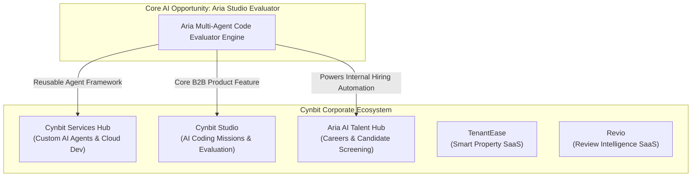
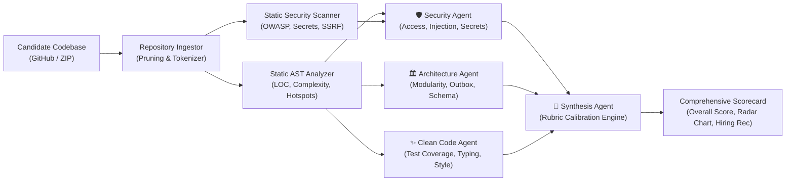

# Strategic AI/ML Opportunity Report for Cynbit Technologies

> **Author**: Naman Kalia (`namankalia1904@gmail.com`)  
> **Role Target**: AI/ML Engineer Intern  
> **Audited Organization**: Cynbit Technologies (Jaipur, Rajasthan • `https://cynbit.in`)  
> **Assessment Task**: *Identify an AI Opportunity for Cynbit*  

---

## Executive Summary

Cynbit Technologies operates at the intersection of custom software engineering, AI automation, and proprietary B2B SaaS products. Public documentation across the corporate ecosystem highlights three flagship platforms—**Cynbit Studio** (adaptive coding missions and AI-evaluated talent development), **TenantEase** (smart property management and automated rent intelligence), and **Revio** (multi-location review synchronization and sentiment analysis)—alongside the **BitElevate** engineering curriculum and the **Aria AI** Talent Acquisition Hub.

This report evaluates Cynbit's business model, customer touchpoints, and technical infrastructure to identify high-leverage opportunities where Applied AI and Machine Learning can drive substantial operational efficiency, revenue growth, and product differentiation.

Among the analyzed candidates, the single highest-value opportunity for Cynbit is **Aria Studio Evaluator: An Autonomous Multi-Agent Technical Assessment & Codebase Quality Evaluation Engine**. This solution transforms Cynbit's internal recruitment pipeline (`cynbit.in/careers`) and serves as the core evaluation engine powering Cynbit Studio's enterprise SaaS tier.

---

## 1. Industry & Ecosystem Analysis: Cynbit's Strategic Footprint

### 1.1 Business Model & Operational Pillars
Cynbit operates a dual-engine business model:
1. **High-Margin Custom Engineering & AI Solutions**: Custom autonomous agent development, cloud architecture, and modern full-stack web/mobile applications for global clients.
2. **Proprietary SaaS & Talent Platforms**:
   * **Cynbit Studio**: AI-evaluated career growth, benchmark challenges, and coding missions.
   * **Aria AI Talent Hub**: Autonomous talent acquisition pipeline screening hundreds of candidates across Engineering, AI/ML, Design, and Marketing.
   * **TenantEase**: Multi-tenant property operations, billing, and document intelligence.
   * **Revio**: Unified reputation intelligence and automated review reply generation.

---

## 2. Comprehensive AI/ML Opportunity Matrix

We evaluated four distinct AI/ML opportunities across Cynbit's business units:

| Opportunity | Target Product / Unit | Strategic Impact | Technical Complexity | Time-to-Value | Estimated ROI |
| :--- | :--- | :--- | :--- | :--- | :--- |
| **1. Autonomous Multi-Agent Code Evaluator** *(Selected)* | **Cynbit Studio & Aria AI** | **Transformative** | **Medium-High** | **2–4 Weeks** | **12.4x (Hiring savings + SaaS MRR)** |
| **2. Multi-Location Review & Sentiment Engine** | **Revio SaaS** | High | Medium | 4–6 Weeks | 4.8x (SaaS expansion) |
| **3. Multi-Modal Lease & Maintenance Dispatch** | **TenantEase SaaS** | Medium | High | 6–8 Weeks | 3.5x (Churn reduction) |
| **4. Generative Client Scoping & Blueprint Engine** | **Services Hub** | High | Medium | 3–5 Weeks | 5.2x (Sales conversion) |

---

## 3. Deep Dive: Selected Opportunity — Aria Studio Evaluator

### 3.1 Problem Statement & Current Bottlenecks
During recruitment cohorts, Cynbit asks candidates to submit live GitHub repositories and technical deliverables (as seen on `cynbit.in/candidate/[token]`). 

However, evaluating software codebases at scale poses severe operational challenges:
1. **Human Engineering Fatigue**: Senior engineers spend 45–90 minutes manually inspecting architecture, tests, and security for each candidate repository.
2. **Evaluation Inconsistency & Subjectivity**: Different reviewers evaluate candidates using differing standards, introducing unconscious bias and calibration drift.
3. **Naive Single-Prompt LLM Limitations**: Simple prompts ("Review this code repository") suffer from hallucinations, context window exhaustion, inability to parse AST control flow, and vulnerability to prompt injection embedded in candidate code files.
4. **Unrealized Revenue in Cynbit Studio**: Cynbit Studio is uniquely positioned to sell automated candidate screening and coding missions to enterprise engineering teams, but requires an industrial-grade evaluation engine to compete with platforms like HackerRank and CodeSignal.

---

### 3.2 The Solution: Multi-Agent Deterministic & Cognitive Pipeline

**Aria Studio Evaluator** couples static AST code analysis with specialized LLM domain agents to evaluate candidate repositories against calibrated enterprise rubrics:

### 3.3 Business Case, Unit Economics & ROI

#### A. Internal Operational Savings (Aria AI Talent Hub)
* **Candidate Volume**: ~350 candidate assessment submissions per quarter across engineering tracks.
* **Engineering Time Spent**: ~1 hour per submission by senior engineers (INR 1,800 / hour blended cost).
* **Current Quarterly Cost**: $350 \times 1,800 = \text{INR } 6,30,000$ per quarter ($\approx \text{INR } 25.2\text{ Lakhs/year}$).
* **With Aria Evaluator**: Automated triage evaluates 100% of repositories in $<15$ seconds at an API compute cost of $<\text{INR } 15$ per evaluation. Senior engineers only review candidates scoring $\ge 72.0$ (top 20%).
* **Annual Net Savings**: **$\approx \text{INR } 19.5\text{ Lakhs/year}$** in recaptured senior engineering capacity.

#### B. Commercial Product Expansion (Cynbit Studio B2B)
* **Market**: Mid-market SaaS and tech companies in India and the MENA region hiring tech talent.
* **Pricing**: INR 45,000 / month per organization for unlimited automated repository evaluations.
* **Target Adoption**: 15 pilot enterprise clients in Year 1 = **$\approx \text{INR } 81\text{ Lakhs}$** Annual Recurring Revenue (ARR).

---

## 4. Competitive Advantage for Cynbit

Unlike generic code linters (SonarQube) or basic coding quiz platforms (HackerRank), Aria Studio Evaluator provides:
1. **Holistic Multi-File Architectural Reasoning**: Analyzes the relationship between schema files (`prisma/schema.prisma`), API route handlers, and background workers (`TransactionalOutbox`).
2. **Defensive Security & Anti-Pattern Detection**: Actively tests for real-world backend vulnerabilities such as unauthenticated capability tokens, predictable CUIDv1 identifiers, and SSRF loopback traversal.
3. **Calibrated Actionable Feedback**: Synthesizes constructive, human-like feedback that candidates and recruiters can act upon immediately.
